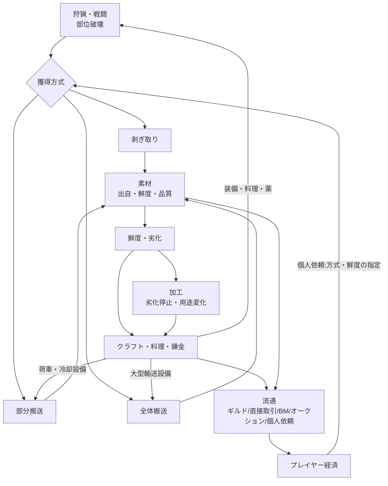
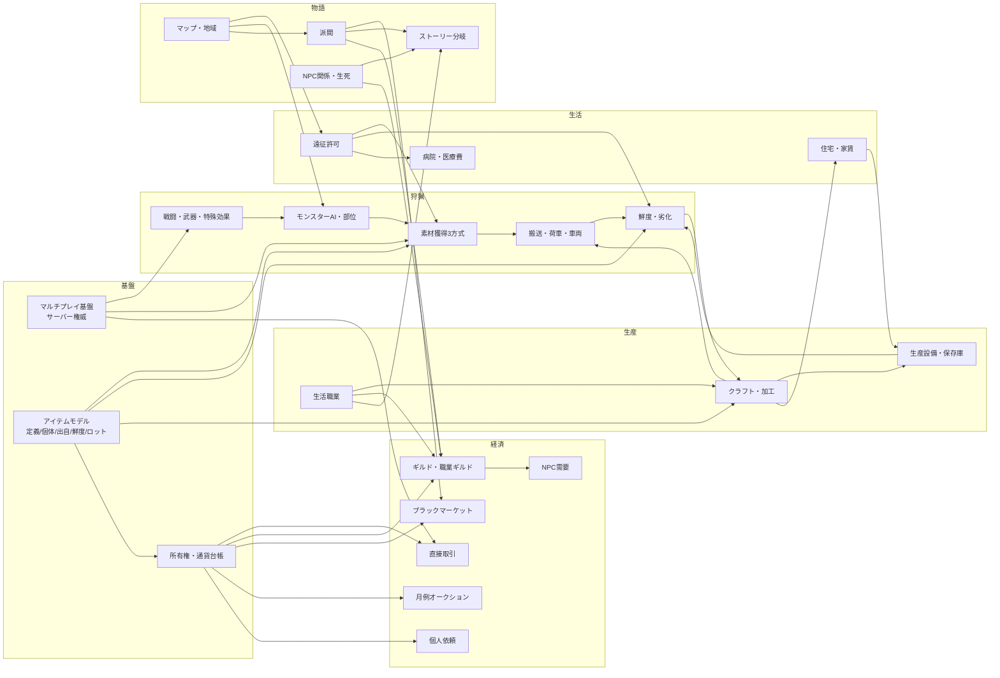
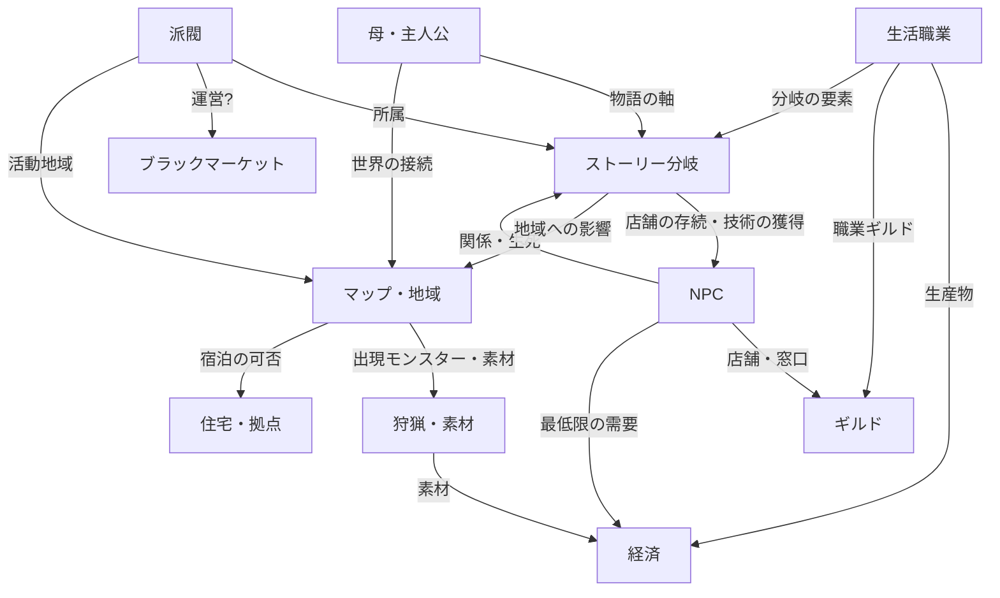

# 06. システム依存関係

> 目的：すべてのシステムが一つのゲームとしてどうつながるかを整理する。
> 図は GitHub 上で表示できる Mermaid 形式です（GitHub でこのファイルを開くと図になります）。
> ここに書かれている関係は、既存の構想から読み取れるものです。新しい関係を加えた箇所には【追加提案】と書いています。

---

## 1. 中心となる循環（狩猟から経済まで）

```
狩猟（戦闘・部位破壊）
 ↓
素材獲得（剥ぎ取り／部分搬送／全体搬送）
 ↓
鮮度・劣化（死体の鮮度 → 素材の鮮度）
 ↓
加工（劣化を止める・用途を変える）
 ↓
クラフト・商品制作（装備・料理・薬・道具・荷車）
 ↓
ギルド・市場・個人依頼（流通）
 ↓
プレイヤー経済
 ↓（強い装備・料理・薬・荷車が狩猟と搬送に戻る）
狩猟へ
```

この流れは一方向ではなく、**循環**です。作られた装備・料理・薬・荷車が次の狩猟と搬送を支え、個人依頼が「どのモンスターを、どの方式で狩るか」を決めます。



---

## 2. 全システムの関係図



---

## 3. 依存関係の表

「必要とするもの」ができていないと、そのシステムは作れません（または仮の形でしか作れません）。

| システム | 必要とするもの（依存先） | これを必要とするもの（依存元） | 開発の段階（当初仕様） |
|---|---|---|---|
| マルチプレイ基盤 | なし | ほぼすべて | 第1段階 |
| アイテムモデル（定義・個体・出自・鮮度） | マルチプレイ基盤 | 素材獲得、劣化、クラフト、台帳、個人依頼 | **第2〜3段階で必要**（下記の注意点を参照） |
| 戦闘・武器 | マルチプレイ基盤 | モンスター討伐、部位破壊 | 第2段階 |
| モンスターAI・部位 | 戦闘 | 素材獲得（部位破壊の状態） | 第2段階 |
| 素材獲得3方式 | モンスター・部位、アイテムモデル | 搬送、劣化、経済全体 | 第3段階 |
| 搬送（荷車・車両） | 素材獲得、（本格版は）クラフト | 部分・全体搬送、協力プレイ | 第3段階（設備の製作は第4段階） |
| 鮮度・劣化 | アイテムモデル、素材獲得 | 加工、品質、個人依頼の条件、保存庫 | 第3段階（追加仕様） |
| クラフト・加工 | アイテムモデル、鮮度 | 装備、荷車、家具、料理、薬 | 第4段階 |
| 生活職業 | クラフト | 需要、ギルド、ストーリー分岐 | 第4段階 |
| 生産設備・保存庫 | クラフト、（設置先として）住宅 | 劣化の抑制、職業の生産 | 第4〜5段階 |
| 所有権・通貨台帳 | アイテムモデル、バックエンド | すべての流通経路 | 第5段階 |
| ギルド（卸売・委託） | 台帳、NPC需要 | 流通、クエスト、職業 | 第5段階 |
| 直接取引 | 台帳 | 経済 | 第5段階 |
| 住宅・家賃 | 台帳、セーブ | 保管庫、設備、経済の出口 | 第5段階 |
| 遠征許可 | 台帳（費用）、探索マップ | 探索の時間制限、期限切れの処理、病院 | 第6段階 |
| 個人依頼 | 台帳（預かり）、アイテムの出自・鮮度 | 職業間の需要のつながり | 第6段階（`06` の案） |
| ブラックマーケット | 台帳、派閥 | 禁制品の流通 | ベータ以降（案） |
| 月例オークション | 台帳（入札金の預かり）、保存（劣化対策） | 希少品の流通 | ベータ以降（案） |
| 派閥 | NPC、ストーリー | ブラックマーケット、ギルド、分岐 | 未定 |
| ストーリー分岐 | 派閥、NPC、職業、共有/個人の境界（Q-S3） | 店舗の存続、地域への影響 | 未定 |
| キャラクタークリエイト | キャラクター表示 | 装備表示、セーブ | ベータ優先（時期は未定） |

### 依存関係から分かる注意点
1. **アイテムモデルは早い段階で必要です。** 取引は第5段階ですが、素材の「出自（モンスター・方式・時刻）」「鮮度」「所有者」というデータの形は、第3段階（プロトタイプの M6〜M8）で決める必要があります。後から変えると、それまでに作った素材データがすべて作り直しになります。
2. **鮮度は多くのシステムの中心にあります。** 加工・保存庫・個人依頼・オークション・職業の需要（料理人・錬金術師）が鮮度に依存しています。Q-S8（ログアウト中の劣化）と Q-S9（保存庫）は早めに決めると後の設計が安定します。
3. **住宅・保存庫・加工は、劣化システムを通じてつながっています。** 保存庫を強くしすぎると加工の価値がなくなります（Q-S9）。
4. **ストーリー分岐は経済に影響する可能性があります。** NPCの店舗の存続を個人状態にするか共有にするか（Q-S3）が決まらないと、ギルドやNPC需要の設計が不安定になります。
5. **対人戦は当面なし、探索はパーティごとに分けることが決まりました**（2026-11-23）。将来の対人戦・乱入イベントに備えて、探索インスタンスに「他のパーティが途中から入る」余地を残した設計にします。

---

## 4. 職業・派閥・NPC・ストーリー・マップの関係



| 要素 | 他の要素への影響（既存構想から） | 状態 |
|---|---|---|
| 生活職業 | 経済の役割分担、職業ギルド、ストーリー分岐の要素 | 【方向性】 |
| 派閥 | 所属によってストーリー・NPCの反応が変わる。ブラックマーケットに裏組織が関わる | 【検討中】 |
| NPC | 関係・生死が分岐に影響。店舗の存続（当初仕様）。ギルドの窓口。最低限の需要 | 【方向性】 |
| ストーリー | 店舗・スキル・技術の獲得、街や地域への影響（当初仕様） | 【方向性】 |
| マップ | 地域ごとの文化（B-2 のモンスター共存など）、宿泊の可否、出現モンスターと素材 | 【検討中】 |
| 母・主人公 | 世界の接続（＝マップの存在理由）、物語の軸 | 【確定】（基本設定） |

### 関係から見える、決めておくべき接点
- 職業の選択がストーリー分岐の要素になる → 職業の変更（Q-S13）が物語にどう影響するか
- 派閥ごとに利用できる店舗・取引がある → 派閥の詳細（Q-W1）が経済設計の前提になる
- マップの地域ごとにモンスターと素材が決まる → ベータの地域（Q-W5）が素材表の前提になる
- B-2（モンスター共存の街）の文化は、狩猟や素材の流通と対立する可能性がある【追加提案：物語上の論点として検討の価値あり】

---

## 5. ベータ版の構築順（依存関係から見た案）

`04-prototype-plan.md` と当初仕様の段階を、依存関係に沿って並べたものです。**順番の確定ではありません。**

```
[第1段階] マルチプレイ基盤・キャラ操作・視点（一人称⇔三人称）
    ↓
[第2段階] 戦闘・モンスター・部位 ──┐
    ↓                               │
[第3段階] アイテムモデル ★ ─→ 素材獲得3方式 → 搬送 → 鮮度
    ↓
[第4段階] 加工・クラフト・生活職業・生産設備
    ↓
[第5段階] 台帳 → ギルド・直接取引・住宅（ベータに含める）
    ↓
[第6段階] 遠征許可（ベータに含める）・個人依頼
    ↓
[第7段階] ベータ統合（2マップ：A-1 と A-3）
```
★ アイテムモデルは、取引より前に、プロトタイプの段階で形を決めておく必要があります。
